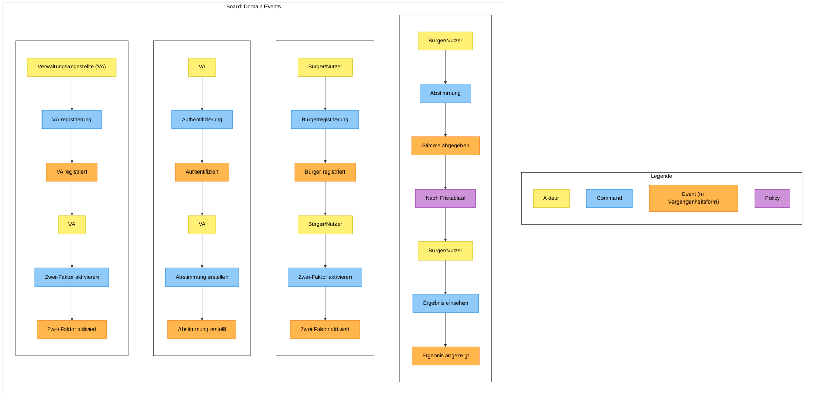
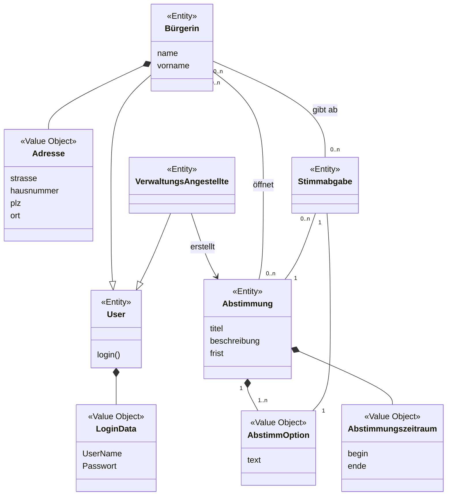

## Event Storming

**Bearbeitung:** Gemeinsam erstellt. In Mermaid übertragen durch Timo.



## Domainmodel

**Bearbeiter:** Ronny 



## Bounded Contexts

**Bearbeiter:** Timo

```mermaid
flowchart LR
    subgraph kontoverwaltung ["Kontoverwaltung"]
        direction TB
        K1["Bürgerin"]
        K2["VerwaltungsAngestellte"]
        K3["Bürger registriert<br/>Zwei-Faktor aktiviert<br/>Authentifiziert"]:::event
    end

    subgraph abstimmungsverwaltung ["Abstimmungsverwaltung"]
        direction TB
        V1["Abstimmung<br/>AbstimmOption<br/>Abstimmungszeitraum"]
        V2["Abstimmung erstellt"]:::event
    end

    subgraph stimmabgabe ["Stimmabgabe"]
        direction TB
        S1["Stimmabgabe"]
        S2["Stimme abgegeben"]:::event
    end

    subgraph abstimmungsansicht ["Abstimmungsansicht"]
        direction TB
        R1["Abstimmungsergebnis"]
        R2["Ergebnis angezeigt"]:::event
    end

    kontoverwaltung -- "Rolle (IstVa)" --> abstimmungsverwaltung
    kontoverwaltung -- "Rolle (IstBuerger)" --> stimmabgabe
    abstimmungsverwaltung -- "AbstimmungId, Zeitraum, Optionen" --> stimmabgabe
    stimmabgabe -- "Stimmen nach Fristablauf" --> abstimmungsansicht

    classDef box fill:#fff,stroke:#000,color:#000
    classDef event fill:#ffb74d,stroke:#ef6c00,color:#000
    class kontoverwaltung,abstimmungsverwaltung,stimmabgabe,abstimmungsansicht box
```



## Domain Services und Repositories

**Bearbeiter:** Ronny

### Services

- NutzerService
    - Art: Anwendungsservice
    - Aufgabe:
        - Steuert anmeldung von Verwaltungsangestelltinnen und Bürgerinnen
    - Methoden
        - registriereBürgerin(name, vorname, adresse)
        - generiere2FACodes()
        - login(nutzername, passwort)
        - isVA(): bool
- AbstimmungsService
    - Art: Domain Service
    - Aufgabe:
        - Erstellt Abstimmungen
        - lädt Informationen zu Abstimmungen
        - lädt Ergebnisse zu Abstimmungen
    - Methoden
        - erstelleAbstimmung(titel, beschreibung, frist, abstimmOptionen): Optional\<int\>
        - getAbstimmung(abstimmId): Optional\<Abstimmung\>
        - getAbstimmungsErgebnis(abstimmId): Optional\<AbstimmErgebnis\>
- StimmabgabeService
    - Art: Anwendungsservice Service
    - Aufgabe: Steuert die Stimmabgabe durch Bürgerinnen
    - Methoden
        - stimmeAb(abstimmungsId, abstimmOption, buergerinnenId)
- ErgebnisService
    - Art: Anwendungsservice Service
    - Aufgabe: Steuert die Anzeige von Abstimmergebnissen
    - Methoden
        - getAbstimmErgebnis(abstimmungsId): 

### Repositories

- NutzerRepo
    - Aggregate: Nutzer (Verwaltungsangestellte, Bürgerin)
    - Methoden:
        - save(Nutzer): Optional\<NutzerId\>
        - findById(userId): Optional\<Nutzer\>
- AbstimmungsRepo
    - Aggregate: Abstimmung
    - Methoden:
        - save(Abstimmung): Optional\<AbstimmungId\>
        - findById(abstimmungId): Optional\<Abstimmung\>
        - findOpen(): List\<Abstimmung\>
        - findClosed(): List\<Abstimmung\>
        - getAll(): List\<Abstimmung\>
- StimmabgabeRepo
    - Aggregate: Stimmabgabe
    - Methoden:
        - save(Stimmabgabe)

# Implementationsstrategie

**Bearbeiter:** Gemeinsam besprochen. Niedergeschrieben durch Timo.

## Vorgehen

1. Reihenfolge der Events: 
   Wir wählen die Ereignisse
   "Bürgerin erstellt" 
   "Abstimmung erstellt" 
   "Stimme abgegeben" 
   "Abstimmung abgeschlossen" 
   aus. Die Umsetzung beginnen wir mit "Abstimmung erstellt" im Context der
   Abstimmungsverwaltung.
2. Von innen nach außen: Pro Context zuerst Value Objects und Entities mit
   ihren, dann das Repository-Interface, die H2 Datenbank, das zugehörige
   Repository für dem umgang mit der DB und den Anwendungsservice. Die
   Oberfläche folgt in einer späteren Übung.
3. Test zuerst (TDD): Vor jeder Implementierung entsteht der Test (Übung 4).
4. Modularität: Jeder Bounded Context ist ein eigener Paketbaum. Contexts kennen
   einander nur über IDs und definierte Schnittstellen.
5. Testbarkeit: Die Domänenschicht kommt ohne Framework aus.
   Helidon als Webserver und für die Infrastruktur um JDBC zu verwenden.
   Wir nutzen Dependency Injection. Organisieren unser Projekt in der
   Hexagonalen Architektur und definieren für die Repositories Interfaces.
   Die Domänenlogik testen wir mit reinen Unit-Tests. Anwendungsservices testen
   wir bei Bedarf mit einem In-Memory-Repository.

## Paketstruktur

**Bearbeiter:** Ronny

```
de.mse.votee_backend
+-- abstimmungsverwaltung
+-- domain
|   +-- model abstimmungId, titel, beschreibung, abstimmungsOptionen, abstimmungszeitraum
|   +-- repository AbstimmungRepository (Interface, Port)
+-- application AbstimmungService
+-- infrastructure H2AbstimmungRepository (Adapter)
```
